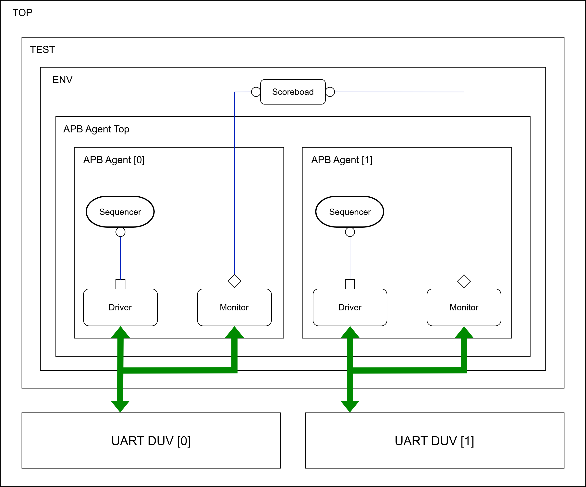

# Verification-of-APB-based-UART

# 📘 Overview

This project focuses on the **functional verification of an APB-based UART Master Core RTL**.
 The verification is carried out using a **UVM (Universal Verification Methodology)** environment designed to ensure the correctness, reliability, and robustness of UART operation under various test scenarios.

Two UART cores are instantiated and connected to simulate **data transmission and reception**. The verification ensures that all UART functionalities perform as expected and comply with the APB protocol.

## 🔌 APB Protocol Overview

The **Advanced Peripheral Bus (APB)** is a part of ARM’s AMBA (Advanced Microcontroller Bus Architecture) family.
 It is designed for connecting low-bandwidth peripherals that do not require high performance.

### Key Features:

- Simple and low power consumption
- Supports **read and write** operations
- Uses a **two-phase protocol** (setup and enable phase)
- Synchronous operation with a single clock

## 📡 UART Overview

The **Universal Asynchronous Receiver-Transmitter (UART)** is a serial communication protocol widely used in embedded systems.
 It converts parallel data from the CPU into serial form for transmission and vice versa for reception.

### Basic Operation:

- **TX (Transmit)**: Converts parallel data to serial form
- **RX (Receive)**: Converts received serial data to parallel form
- Communication happens asynchronously (no shared clock)

### Applications:

- Serial communication between microcontrollers and PCs
- Debug consoles and data logging
- Communication with wireless modules (Bluetooth, GPS, etc.)

### Drawbacks:

- Limited distance and data rate
- No built-in error correction beyond parity check
- Requires precise baud rate synchronization

## 🧱 Testbench Architecture

The UVM-based verification environment includes:

- **2 APB Agents** – Each connected to a UART DUV (Design Under Verification)
- **Driver, Monitor, and Sequencer** per agent
- **Scoreboard** for end-to-end checking
- **Assertions and Coverage Collection**

Each UART core transmits and receives data through APB interface transactions, and the verification environment checks protocol compliance and data integrity.

## 🧪 Test Cases

Nine major test scenarios were verified to ensure full UART functionality:

| Test Case           | Description                                                 |
| ------------------- | ----------------------------------------------------------- |
| **Full-Duplex**     | Simultaneous TX and RX verification                         |
| **Half-Duplex**     | Transmission and reception in an alternate fashion          |
| **Loopback**        | Internal loopback testing of data integrity                 |
| **Parity Error**    | Verification of parity bit detection and reporting          |
| **Break Error**     | Checking for a continuous low-line condition                |
| **Overrun Error**   | Buffer overflow handling                                    |
| **Framing Error**   | Incorrect data frame configuration condition                |
| **THR Empty Error** | Validation of the transmit holding register empty condition |
| **Timeout Error**   | A smaller number of data characters received                |

---

## 📊 Results & Coverage

- ✅ **100% Functional Coverage Achieved**
- ✅ All Assertions Passed
- ✅ Verification goals and protocol compliance met

## 🏁 Conclusion

This project successfully verified the **APB-based UART Master Core RTL** using a **UVM-based testbench**, achieving **100% functional coverage** across multiple UART operation modes and error conditions.
 The verification environment is scalable for integrating more agents and extending coverage for advanced UART configurations.
